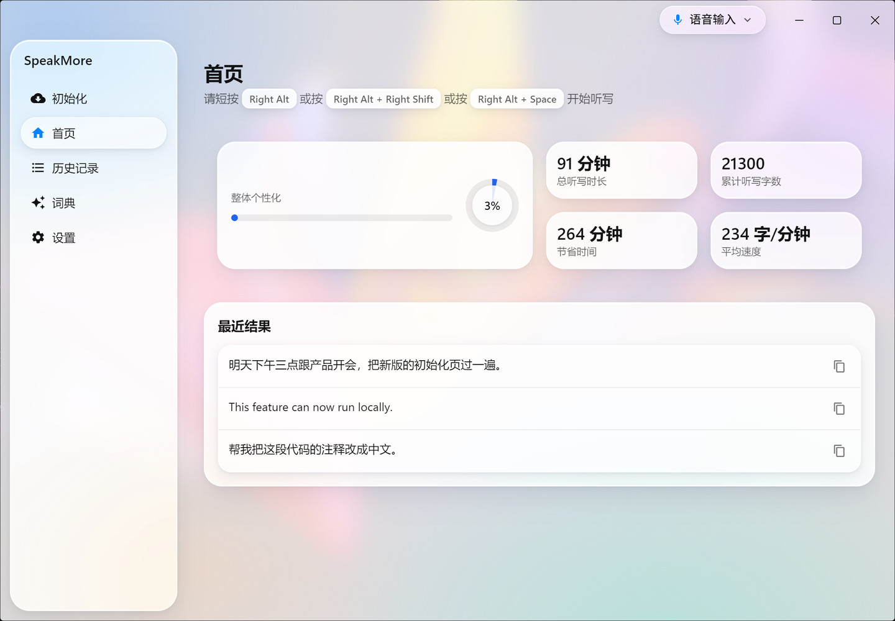
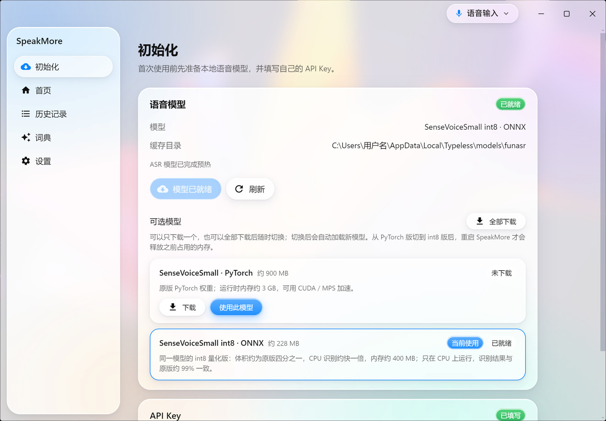
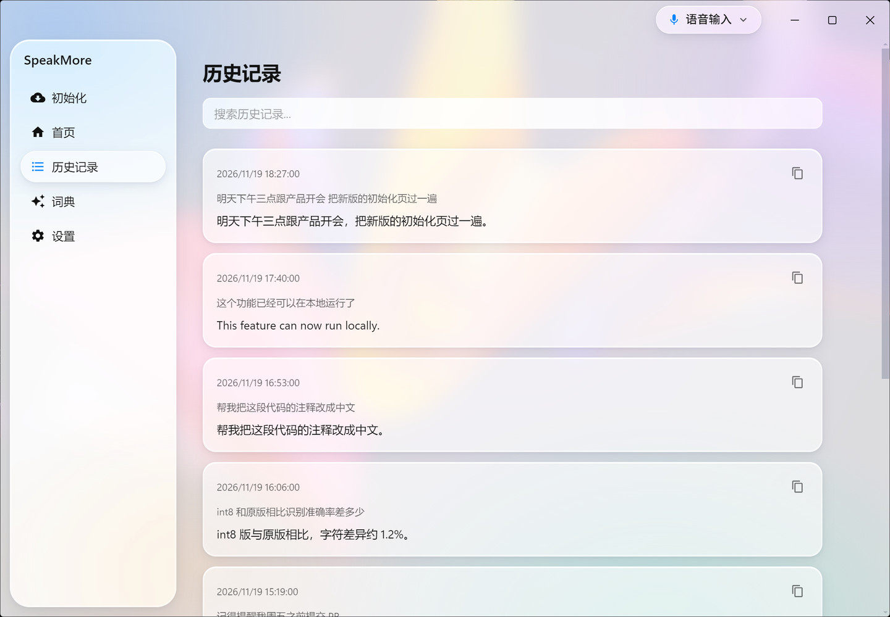
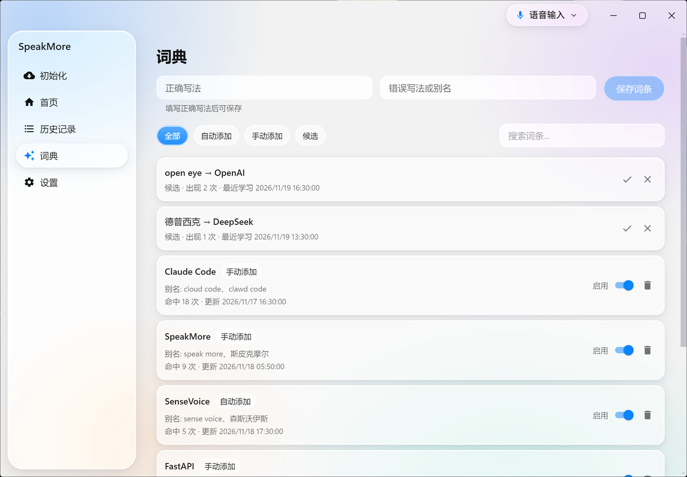
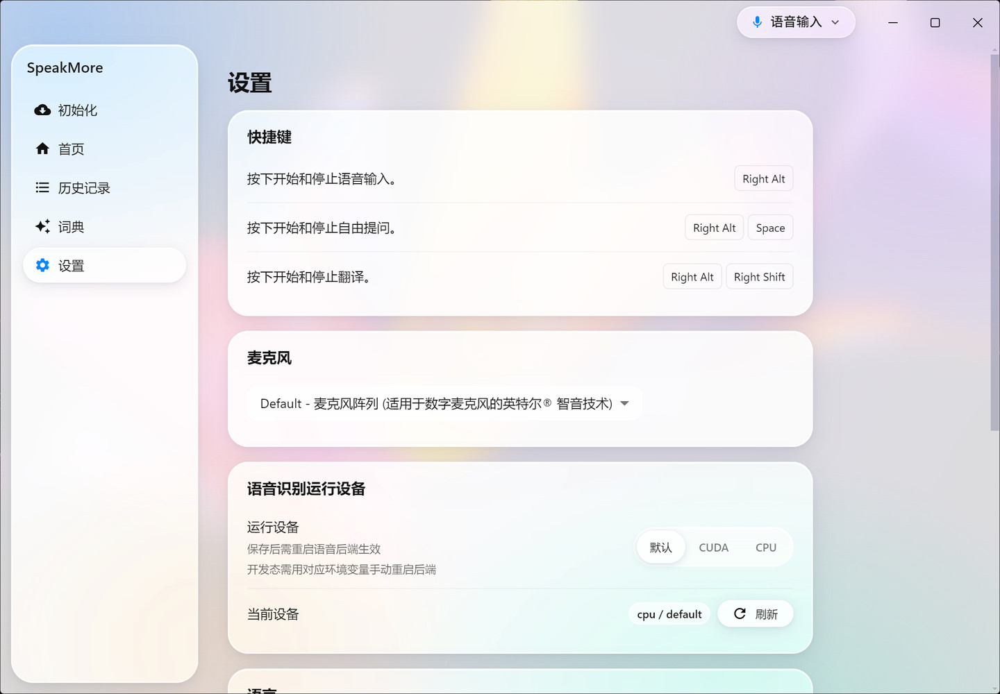

# SpeakMore

SpeakMore 是一个本地语音输入工具。本地 FastAPI 后端负责音频转写和大模型文本处理，桌面端有两个版本，连同一个后端、读写同一份本地数据：

- **Electron 版**（`electron-app/`）：Windows 是当前稳定版；macOS 已支持本地 `.app` / DMG 构建，签名和公证仍需要发布凭证。
- **原生 macOS 版**（`macos-app/`）：用 Xcode / SwiftUI 重写，不依赖 Electron，详见 [`macos-app/README.md`](macos-app/README.md)。

两个版本的主窗口都是 Liquid Glass 风格（半透明玻璃窗口、卡片和按钮），字号和文案共用同一套规范。

支持两个 ASR 模型，可在“初始化”页单独下载、全部下载、切换或删除：

| 模型 | 下载体积 | 运行内存 | 说明 |
| --- | --- | --- | --- |
| SenseVoiceSmall · PyTorch（默认） | 约 900 MB | 约 3 GB | FunASR 原版权重，可用 CUDA / MPS |
| SenseVoiceSmall int8 · ONNX | 约 229 MB | 约 0.5 GB | 同一权重的 int8 量化版，sherpa-onnx 推理，只用 CPU，速度约快一倍 |

发布包不内置模型；首次运行进入“初始化”页后，由用户选择下载并加载，下载失败时会显示明确错误。

## 界面预览

下面是 Windows（Electron）版的主窗口，截图里的历史、词典和统计都是演示数据。原生 macOS 版是同样的五个页面。

<p align="center">
  
</p>
<p align="center"><sub>首页——个性化进度、累计听写时长 / 字数、最近结果</sub></p>

<table>
  <tr>
    <td width="50%"><br><sub>初始化——下载、切换、删除语音模型，填写 API Key</sub></td>
    <td width="50%"><br><sub>历史记录——原始转写和润色结果，可搜索、复制</sub></td>
  </tr>
  <tr>
    <td width="50%"><br><sub>词典——手动词条、自动学习的候选词条</sub></td>
    <td width="50%"><br><sub>设置——快捷键、麦克风、运行设备、语言和大模型</sub></td>
  </tr>
</table>

## 功能

- Windows `Right Alt` / macOS `Option`：听写，结果自动粘贴；无法确认可信输入目标时显示悬浮面板。
- Windows `Right Alt + Space` / macOS 右侧 `Option + 右侧 Command`：自由提问，结果显示在悬浮面板，不自动粘贴；有可信选区时携带选区上下文。
- Windows `Right Alt + Right Shift` / macOS 右侧 `Option + Shift`：语音翻译，结果粘贴到当前光标位置；无法确认可信输入目标时显示悬浮面板。
- `Escape`：取消当前未完成语音会话，或关闭当前悬浮面板。
- 录音时显示悬浮胶囊和麦克风音量。
- 长录音：一次最多录 30 分钟。后端按 30 秒一段边说边识别，封口的段马上交给大模型润色并存起来，说完只需要等最后一段。
- 主窗口包含初始化、首页、历史记录、词典和设置。
- 点主窗口的关闭按钮不退出应用，快捷键和语音链路继续在后台可用：Windows 上窗口会藏起来，任务栏图标消失、只留托盘图标，从托盘“打开主窗口”恢复；macOS 上是最小化。托盘“退出”才真正结束。
- 初始化页的已下载模型有“删除”按钮，弹确认框后删除，释放磁盘空间；下载或加载中不能删。
- 历史、设置、词典和自动学习候选只保存在本机。

自动粘贴必须先确认可信文本输入目标；不满足条件时显示悬浮卡片，不静默写剪贴板和发送粘贴快捷键。如果录音期间焦点被别的窗口抢走，会先把录音开始时锁定的窗口还原到前台再粘贴，还原失败才显示悬浮卡片。粘贴完成后会恢复你原来的剪贴板。macOS 自动学习只在自动粘贴成功后短时观察本轮目标，选区上下文只服务自由提问。

## 从源码开始用

拉下仓库后，按系统选入口（根目录的 `npm start` 启动的是 Electron 版，**不会**自动启动原生 macOS 版）：

| 系统 | 版本 | 入口 |
| --- | --- | --- |
| Windows | Electron 版 | 准备好后端后运行 `npm run install:shortcut:win`，桌面和开始菜单出现 SpeakMore 图标，点一下就启动 |
| macOS | 原生 SwiftUI 版 | 准备好后端后运行 `bash macos-app/Tools/install-local.sh`，装到 `/Applications`，点图标启动 |
| macOS | Electron 版（备选） | 按下面“开发安装”和“启动”章节运行 `npm start` |

两种 macOS 版本读写同一份本地数据、连同一个后端，可以互换使用，但同一时间只开一个（快捷键会冲突）。

原生 macOS 版的完整步骤：

1. 装 Xcode 26+ 和 XcodeGen（`brew install xcodegen`）。
2. 按下面“开发安装”章节的“安装后端依赖”建好 `server/.venv`（App 会用它拉起后端）。
3. 运行 `bash macos-app/Tools/install-local.sh`。
4. 第一次打开时，在系统设置里给 SpeakMore 授权麦克风、输入监控和辅助功能；之后在“初始化”页下载模型、在设置页填大模型 API Key。

本机安装版依赖当前仓库检出，仓库目录不要移动或删除。其它用法（Xcode 调试、打包 zip / DMG、测试）见 [`macos-app/README.md`](macos-app/README.md)。

## 发布包

Windows x64 当前生成解压即用 zip。macOS 当前可生成本地 `.app`、zip 和 DMG。发布包包含：

- `SpeakMore.exe` 或 `SpeakMore.app`
- Electron 运行文件
- 本地后端可执行文件
- Windows 文本观察 helper 或 macOS helper 源码
- `ffmpeg`
- Renderer 构建产物

模型不打包。首次运行需要联网下载 SenseVoiceSmall，Windows 默认缓存到 `%LOCALAPPDATA%\Typeless\models\funasr`，macOS 默认缓存到 `~/Library/Application Support/SpeakMore/models/funasr`。用户在“初始化”页点击下载后，页面会显示下载/加载状态、耗时、成功或失败结果。离线环境可以提前准备模型目录，并通过 `SENSEVOICE_SMALL_MODEL_DIR` 指向该目录。

## 分支与发布策略

`main` 是统一源码主线，Windows 和 macOS 代码都合并在这里。源码仓库只保存代码、测试、配置、打包脚本和文档，不提交打包后的 ZIP、DMG、EXE、APP、blockmap、`release/` 或 `release-artifacts/`。

发布时从 `main` 拉 `release/vX.Y.Z` 分支，只做版本号、签名、公证和 release note 等发布准备。打包产物由本机或 CI 生成后上传到 GitHub Releases 附件，不用 Git 分支长期保存产物。

开发者从源码使用时直接拉 `main` 并按“开发安装”和“启动”章节运行。普通用户使用时不需要拉源码，应在 GitHub Releases 下载对应平台产物：

- Windows：下载 ZIP，解压后运行 `SpeakMore.exe`。
- macOS：下载 DMG 或 ZIP，安装或解压后运行 `SpeakMore.app`。

## 项目结构

```text
.
├── server/                         # 本地 FastAPI 后端
│   ├── main.py                     # HTTP / WebSocket 接口、就绪状态、音频转码
│   ├── asr.py                      # SenseVoiceSmall 加载与转写
│   ├── refiner.py                  # 大模型文本清洗、提问、翻译
│   ├── runtime_config.py           # .env、HOST、PORT、CORS 配置
│   └── .env.example                # 后端环境变量模板
├── electron-app/                   # Electron 主进程和桌面壳
│   ├── main.js                     # 主进程组合根
│   ├── preload.js                  # Renderer 安全 IPC 桥接
│   ├── right-alt-listener.ps1      # Windows 低级键盘监听器
│   ├── macos-option-listener.c     # macOS 开发态 Option 监听器
│   ├── macos-platform-helper.m     # macOS Accessibility、粘贴、选区和文本观察 helper
│   ├── audio-session-control.ps1   # Windows 后台音频会话静音/恢复
│   ├── windows-text-observer/      # UIA 文本观察 helper
│   └── renderer/                   # Vite + React + MUI + TypeScript 前端
├── macos-app/                      # 原生 macOS 版（SwiftUI，不依赖 Electron）
│   ├── Packages/SpeakMoreCore/     # 与界面无关的逻辑（协议、会话状态机、后端客户端等）
│   ├── Packages/SpeakMorePlatform/ # 系统接口（快捷键、录音、辅助功能、粘贴）
│   ├── SpeakMore/                  # 主窗口、菜单栏和悬浮窗口
│   └── Tools/                      # 端到端、打包和资源生成脚本
├── shared/                         # 前后端共享元数据
├── scripts/                        # 验证、发布和 Windows 启动脚本
├── packaging/                      # 打包配置和应用图标
├── package.json                    # 根启动、构建和验证脚本
└── AGENTS.md                       # 项目协作约定
```

## 环境要求

- Windows 10/11 x64。
- macOS 15+ arm64 当前按开发态 MVP 验证；原生 macOS 版还需要 Xcode 和 XcodeGen（见 `macos-app/README.md`）。
- Node.js 24 推荐。
- Python 3.10+。
- Windows 需要 PowerShell；macOS Option 监听器需要 Xcode Command Line Tools 提供的 `clang`。
- `ffmpeg`。
- 可用麦克风。
- 可用的大模型 API Key；默认不包含任何真实 Key。

## 开发安装

安装根依赖：

```bash
npm ci
```

安装前端依赖：

```bash
cd electron-app/renderer
npm ci
```

安装后端依赖：

Windows PowerShell：

```powershell
cd ..\..\server
python -m venv .venv
.\.venv\Scripts\Activate.ps1
pip install -r requirements.txt
```

macOS：

```bash
cd ../../server
python3 -m venv .venv
source .venv/bin/activate
pip install -r requirements.txt
```

复制后端环境变量模板：

Windows PowerShell：

```powershell
copy server\.env.example server\.env
```

macOS：

```bash
cp server/.env.example server/.env
```

示例配置：

```env
DEEPSEEK_API_KEY=
DEEPSEEK_BASE_URL=https://api.deepseek.com/v1
SENSEVOICE_SMALL_MODEL_DIR=
TYPELESS_MODEL_CACHE_DIR=
FUNASR_DEVICE=
HOST=127.0.0.1
PORT=8000
CORS_ALLOWED_ORIGINS=null,http://127.0.0.1:5173,http://localhost:5173
```

`server/.env` 已被忽略，不要提交真实密钥。客户端设置页传入的大模型配置优先；DeepSeek 变量仅作为本地后端回退配置。

LLM provider、API Key 和模型名由设置页保存到本机 Electron `userData/local-data/settings.json`。

未填写当前 provider 的 API Key 时，语音录音会在启动前被拦截，不会打开麦克风或连接语音后端。默认 provider 是 DeepSeek。

## 启动

macOS 开发态需要先在系统设置里允许当前终端或 Electron 使用“辅助功能”权限，否则全局 Option 监听器、自动粘贴、选区读取和自动学习观察不可用。

设置页会显示 macOS 辅助功能权限状态，并提供打开系统设置的入口。当前 macOS 阶段会在可信输入目标中自动粘贴听写和翻译结果；粘贴成功后会短时观察本轮 focused text target 的用户修正并生成自动学习候选。权限缺失、目标不可用或粘贴失败时会展示悬浮面板。自由提问会读取 AX confirmed 选区作为上下文，结果仍只展示悬浮面板。

构建前端：

```powershell
npm run renderer:build
```

检查本地开发前置条件：

```powershell
npm run doctor
```

`npm run doctor` 只检查，不安装依赖。它会确认根目录 Electron 依赖、renderer 构建产物、`server/.venv` 和后端核心包是否存在。

启动后端：

```powershell
npm run server
```

`npm run server` 必须使用 `server/.venv` 中的 Python，并会先检查 `fastapi`、`uvicorn`、`funasr`、`torch`、`torchaudio` 和 `transformers` 等核心包。缺少 venv 或核心包时会直接失败并打印准备命令，避免误用 Conda 或系统 Python。如需临时指定其它 Python，可设置 `SPEAKMORE_SERVER_PYTHON`。

检查后端状态：

Windows PowerShell：

```powershell
Invoke-WebRequest http://127.0.0.1:8000/health | Select-Object StatusCode
Invoke-WebRequest http://127.0.0.1:8000/model/status | Select-Object StatusCode
Invoke-WebRequest http://127.0.0.1:8000/ready | Select-Object StatusCode
```

macOS：

```bash
curl -i http://127.0.0.1:8000/health
curl -i http://127.0.0.1:8000/model/status
curl -i http://127.0.0.1:8000/ready
```

含义：

- `/health` 返回 200：后端进程存活。
- `/model/status` 返回 200：模型初始化状态可查询。
- `/ready` 返回 200：ASR 模型已预热，语音链路可用。
- `/ready` 返回 503：模型未开始下载、正在下载/加载，或下载/加载失败。

启动 Electron：

```powershell
npm start
```

`npm start` 会先检查根目录 Electron 依赖和 `electron-app/renderer/dist/index.html`。缺少时不会打开 Electron，而是提示运行 `npm install` 或 `npm run renderer:build`。

## SenseVoiceSmall 模型

模型查找顺序为：

1. `SENSEVOICE_SMALL_MODEL_DIR`
2. 用户设置的 `modelCacheDir` / 后端 `TYPELESS_MODEL_CACHE_DIR`
3. Windows `%LOCALAPPDATA%\Typeless\models\funasr`，macOS `~/Library/Application Support/SpeakMore/models/funasr`
4. `%USERPROFILE%\.cache\huggingface\hub` 或当前用户的 Hugging Face cache
5. 都未命中时，初始化页点击下载后保存到用户设置的 `modelCacheDir`，未设置时保存到平台默认模型目录

如果手动配置 `SENSEVOICE_SMALL_MODEL_DIR`，目录内必须包含 SenseVoiceSmall 所需文件；int8 版对应 `SENSEVOICE_SMALL_INT8_MODEL_DIR`，目录内需要 `model.int8.onnx` 和 `tokens.txt`。

当前模型由设置里的 `asrModelId` 决定，单独运行后端时也可以用环境变量 `SPEAKMORE_ASR_MODEL_ID=sensevoice-small-int8` 指定。

“初始化”页可以删除已下载的模型（包括当前模型），只会删应用自己下载到模型目录里的那一份；`SENSEVOICE_SMALL_MODEL_DIR` 指定的目录和 Hugging Face 缓存可能被别的程序共用，页面只提示它们的位置，不会删除。

### ASR 运行设备

后端通过 `FUNASR_DEVICE` 选择 FunASR 运行设备：

- 空值：保持默认稳定策略，优先 CUDA，最后 CPU，不自动启用 MPS。
- `auto`：自动探测，优先 CUDA，其次 macOS MPS，最后 CPU。
- `cpu`：固定 CPU，最稳定。
- `cuda` / `cuda:0`：显式使用 CUDA；不可用时回退 CPU。
- `mps`：显式使用 Apple Silicon MPS；不可用或初始化失败时回退 CPU。

`GET /model/status` 会返回 `device`、`requested_device`、`device_source` 和 `fallback_reason`，用于确认实际运行设备和回退原因。

macOS 设置页提供“语音识别运行设备”入口，可选择默认、MPS 或 CPU。开发态后端通常由开发者手动启动，`npm run server` 会优先使用 `server/.venv`；如需验证 MPS，可使用 `FUNASR_DEVICE=mps npm run server`。打包态由 Electron 启动内置后端；用户切换 MPS 后，需要真正退出应用再重新打开，后端会按本地设置注入 `FUNASR_DEVICE=mps` 并加载模型。

Windows 设置页提供“语音识别运行设备”入口，可选择默认、CUDA 或 CPU。开发态后端通常由开发者手动启动；如需验证 CUDA，可使用 `$env:FUNASR_DEVICE='cuda:0'; npm run server`。打包态由 Electron 启动内置后端；用户切换 CUDA 后，需要真正退出应用再重新打开，后端会按本地设置注入 `FUNASR_DEVICE=cuda:0` 并加载模型。

macOS MPS 目前只作为 Apple Silicon 实验加速路径，不承诺性能指标。Windows CUDA 选项只适用于 NVIDIA CUDA 环境；Intel Arc 等非 NVIDIA GPU 不会因为选择 CUDA 自动获得加速，后端会回退 CPU 并通过 `fallback_reason` 暴露原因。

## 打包

打包脚本可以保留在 `main`，但产物不能提交到 Git。生成的 ZIP、DMG、EXE、APP 和 blockmap 只用于本机验证或上传到 GitHub Releases。

Windows 便携包：

```powershell
npm run build:portable:win
npm run verify:portable:win
```

macOS 本地 App、zip 和 DMG：

```bash
npm run build:app:mac
npm run verify:app:mac
```

macOS 打包态 MPS 重启生效烟测：

```bash
npm run smoke:app-mps:mac
```

macOS release 签名和公证需要先提供 Developer ID 和 Apple notarization 凭证，再运行：

```bash
npm run build:release:mac
```

支持的签名和公证环境变量：

- 签名：`CSC_LINK` 或 `CSC_NAME`，以及需要时的 `CSC_KEY_PASSWORD`。
- App Store Connect API Key：`APPLE_API_KEY`、`APPLE_API_KEY_ID`、`APPLE_API_ISSUER`。
- Apple ID：`APPLE_ID`、`APPLE_APP_SPECIFIC_PASSWORD`、`APPLE_TEAM_ID`。
- Keychain profile：`APPLE_KEYCHAIN_PROFILE`，需要时配合 `APPLE_KEYCHAIN`。

没有签名凭证时，`build:app:mac` 会生成本地 ad-hoc 签名产物并跳过公证，适合本机验证；公开分发必须使用 `build:release:mac`。

## 本地数据

Electron 主进程把业务数据写到：

```text
Electron userData/local-data/
```

主要文件和目录：

- `settings.json`：本地设置。
- `history.json`：最近历史列表。
- `history-stats.json`：累计统计。
- `dictionary.json`：正式词典词条。
- `dictionary-candidates.json`：自动学习候选词条。
- `recording.log`：本地排查日志。
- `recordings/`：录音相关本地产物目录。

这些内容不进入仓库，也不进入便携发布包。

### 词典与自动学习隐私

词典正式词条和自动学习候选只保存在本机 `userData/local-data/`。每轮请求只会把启用词条中按动态分数裁剪后的部分传给本地后端，默认 24 条，后端硬上限 40 条。

自动学习只围绕本轮 SpeakMore 自动粘贴结果做短时观察，只接受短词或短语级纠错，不采集无关全局文本，不学习整句改写、摘要结果、问答命令或无上下文大段替换。

## 后端接口

- `GET /health`：后端进程存活检查。
- `GET /model/status`：查询当前模型初始化状态和 `models` 列表；带 `model_id` 时在空闲状态下切换当前模型。
- `POST /model/download`：下载并加载 `model_id` 指定的模型（省略时为当前模型）；`load: false` 只下载不切换。
- `POST /model/delete`：删除 `model_id` 指定的已下载模型（必须明确给出）。下载或加载中返回 409；删的是当前模型时先卸载并回到“未下载”。只删应用自己下载的缓存目录，显式目录环境变量和 Hugging Face 缓存只在 `external_locations` 里报告位置，不会删。
- `GET /ready`：语音链路就绪检查。
- `POST /config/reload`：刷新后端回退配置。
- `POST /ai/voice_flow`：上传完整音频并返回处理结果。
- `WebSocket /ws/rt_voice_flow`：实时录音流接口。

WebSocket 语音流固定输入来自 `16kHz`、单声道、`pcm_s16le` 二进制 chunk，并在 `start_audio.parameters.audio_format` 声明音频格式。兼容上传入口会先把音频转成 PCM16 再交给 ASR。

## 开发验证

前端测试：

```powershell
cd electron-app\renderer
npm test
```

前端构建：

```powershell
npm run renderer:build
```

主进程语法检查：

```powershell
node --check electron-app\main.js
```

快捷键转发测试：

```powershell
node --test electron-app\right-alt-relay.test.js
```

历史统计测试：

```powershell
node --test electron-app\history-stats-store.test.mjs
```

后端核心语音协议验证：

```powershell
npm run verify:voice
```

开源边界验证：

```powershell
npm run verify:open-source
```

后端全部测试：

```powershell
cd server
python -m pytest -q
```

原生 macOS 版测试（在 macOS 上）：

```bash
cd macos-app/Packages/SpeakMoreCore
swift test
```

## 常见问题

### 语音后端未就绪

先检查：

```powershell
Invoke-WebRequest http://127.0.0.1:8000/ready | Select-Object StatusCode
```

如果 `/ready` 是 503，先打开初始化页查看模型状态；常见原因是还没点击下载、模型还在下载/加载、下载失败，或 `SENSEVOICE_SMALL_MODEL_DIR` 配置错误。

### 首次启动很慢

第一次没有本地 SenseVoiceSmall 模型时，需要在初始化页点击下载并等待加载完成。网络慢或无法访问模型源时，语音功能会暂时不可用，页面会保留失败原因。

### 提示未填写 DeepSeek API Key

到设置页的大模型区域填写自己的 API Key 并保存。未填写 API Key 时，录音启动会被拦截。

### 转写时报 ffmpeg 错误

确认 `ffmpeg` 可用：

```powershell
ffmpeg -version
```

主录音链路固定发送 PCM16；兼容入口上传的其他音频仍需要 `ffmpeg` 转码。

### 大模型没有生效

优先检查设置页里的 provider、API Key 和模型名。保存后，Electron 会把配置写入本机 `settings.json`，并随语音或文本请求传给本地后端。

## 开源边界

仓库不会提交以下内容：

- `node_modules/`
- 构建产物
- `server/.env`
- 日志文件
- Python 缓存
- 本地 AI 工作上下文 `docs/ai/context/`
- Electron `userData/local-data/`
